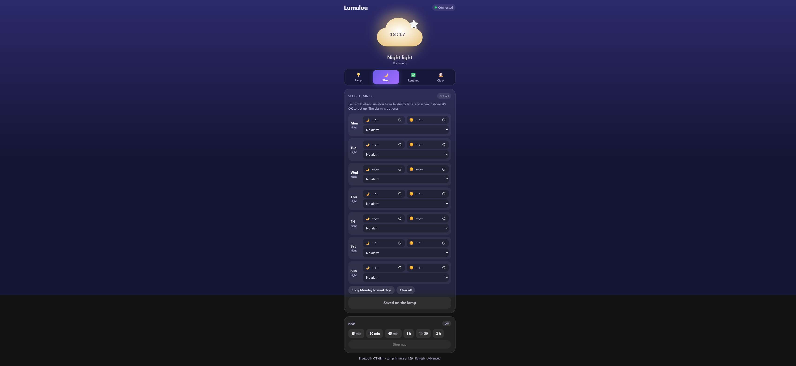

# Lumalou Revival 🌙☁️⭐

**Keep your Fisher-Price Lumalou working after its app was discontinued.**
No Mattel app, no cloud, no account: a €5 ESP32 board talks to the lamp over Bluetooth and gives you a web page on your phone
with everything the app had: light colours, brightness, sounds, volume, the **sleep trainer** (bedtime, wake-up time, alarm),
the **nap timer**, **weekday routines** with tasks, and the **clock**.

| Lamp | Sleep trainer | Routines | Clock |
|---|---|---|---|
|  |  |  |  |

> **Prior art, with thanks:** [stramanu/lumalou](https://github.com/stramanu/lumalou) (MIT) reverse-engineered the same
> protocol first and ships a Python package, an npm package and a Web Bluetooth app. We found it only *after* finishing our
> own independent work (our method is in [docs/REVERSE-ENGINEERING.md](docs/REVERSE-ENGINEERING.md)); the two descriptions of
> the protocol agree. What this project adds: an **always-on ESP32/ESPHome bridge** with a built-in web page, **Home
> Assistant** entities, automatic clock sync, and a byte-level reference of all 68 commands. If you just want to try your lamp from
> a phone or browser, their web app is the quickest start.

> Fisher-Price and Lumalou are trademarks of Mattel, Inc. This is an independent, unofficial interoperability project. It
> contains no Mattel code, keys or binaries. Use at your own risk.

## What you need

* A Fisher-Price **Lumalou** sleep & routine assistant (model **GLD09**; sold in Europe as **GWM53**, UK **GWM52**; it advertises
  over Bluetooth as a 10-digit number).
* Any **ESP32 board with Bluetooth LE** (tested on an ESP32-S3-DevKitC-1) and a USB cable, *or* just a PC with Bluetooth for the
  command-line tool.
* [ESPHome](https://esphome.io) (for the board) or Python 3.10+ (for the PC tool).

## Option A: a permanent bridge on an ESP32 (recommended)

1. Find your lamp's Bluetooth address (lamp powered, the old app closed):
   ```
   cd python && pip install -r requirements.txt && python lumalou_cli.py scan
   ```
2. In `esphome/`: copy `secrets.example.yaml` → `secrets.yaml` and fill in your WiFi. Open `lumalou.yaml` and change the
   lines marked `<-- CHANGE` (board, the lamp's address, your timezone).
3. Plug the ESP32 into your PC and flash it:
   ```
   cd esphome && esphome run lumalou.yaml
   ```
4. Open **http://lumalou.local** on your phone (or the board's IP address, which your router shows). Add it to your home screen.

Within ~10 seconds of power-on the board connects to the lamp, opens the encrypted session, sets the lamp's clock from internet
time and reads all its settings. Keep the board within a few metres of the lamp. Because the lamp accepts only **one**
Bluetooth connection, close the old app if you still have it.

It also shows up in **Home Assistant** automatically (ESPHome integration): colour, brightness, volume, sounds, buttons.

## Option B: from a PC (no extra hardware)

```
cd python
pip install -r requirements.txt
python lumalou_cli.py scan
python lumalou_cli.py AA:BB:CC:DD:EE:FF status
python lumalou_cli.py AA:BB:CC:DD:EE:FF colour 5        # blue
python lumalou_cli.py AA:BB:CC:DD:EE:FF sound 3         # ocean
python lumalou_cli.py AA:BB:CC:DD:EE:FF sync-clock
python lumalou_cli.py AA:BB:CC:DD:EE:FF raw 3a 07       # any command from docs/COMMANDS.md
```

## What works

| Feature | |
|---|---|
| Light: 10 colours (incl. warm/cool spectrum, rainbow, night light), off, brightness 0–9, "stays on for" timer | ✅ |
| Sound: sleep playlist, custom playlist, pink/brown noise, ocean, rain, nature, highway; stop; volume 0–9 | ✅ |
| Lamp clock: set automatically from internet time; clock display on/off, brightness, 12/24 h | ✅ |
| Sleep trainer: bedtime + wake-up time per night, optional alarm (at wake time or later) | ✅ |
| Nap timer 15 min – 2 h | ✅ |
| **🌅 Sunrise wake light** (new, not in the original app): before each wake-up time the light fades red → orange → yellow, brightness 1 → 9, over 10–60 min; runs on the board, with a 2-minute demo button | ✅ |
| Weekday routines: start time + up to 12 tasks; start / back / done / stop; routine volume | ✅ |
| Full live status (mode, what's playing, alarm ringing → "Stop" button) | ✅ |
| **All 12 built-in songs one by one** (Sleep Baby Sleep … Crickets in Space) + a **custom playlist editor** | ✅ |
| Music timer, routine music on/off | protocol known, not in the page yet |

## How it works

The lamp speaks Mattel's encrypted "MPID" protocol: an ECDH (P-256) key exchange with a public key stored in the lamp, a key
schedule seeded with the string `mattel`, and AES-128-CTR packets with CRC-8. Inside, each command is a small framed message to
the lamp's sound-and-light chip. Everything is local: the app never needed Mattel's servers to control the lamp.

* [docs/PROTOCOL.md](docs/PROTOCOL.md): the protocol, layer by layer
* [docs/COMMANDS.md](docs/COMMANDS.md): every command and reply (68 opcodes)
* [docs/REVERSE-ENGINEERING.md](docs/REVERSE-ENGINEERING.md): how we figured it out, and how to do the same for another device
* [docs/HARDWARE.md](docs/HARDWARE.md) and [docs/RESEARCH-IDEAS.md](docs/RESEARCH-IDEAS.md): what's inside, compatible products, ideas
* [blog/BLOG.md](blog/BLOG.md): the full story

## Layout

```
python/            mpid.py (transport + crypto), lumalou.py (commands), lumalou_cli.py (PC tool)
esphome/           lumalou.yaml, components/lumalou (C++ ESPHome component), lumalou-ui/lumalou.js (the web page)
docs/              protocol, command reference, method
blog/              the write-up + screenshots
```

## Safety

* Never write to the lamp's firmware-update service (`00001530-…`). Nothing in this project does.
* Everything here was tested on one lamp (toy-IC firmware 1.99). If yours behaves differently, open an issue with the output of
  `python lumalou_cli.py <address> status -v`.

## License

MIT for everything in this repository (our own code and documentation).
